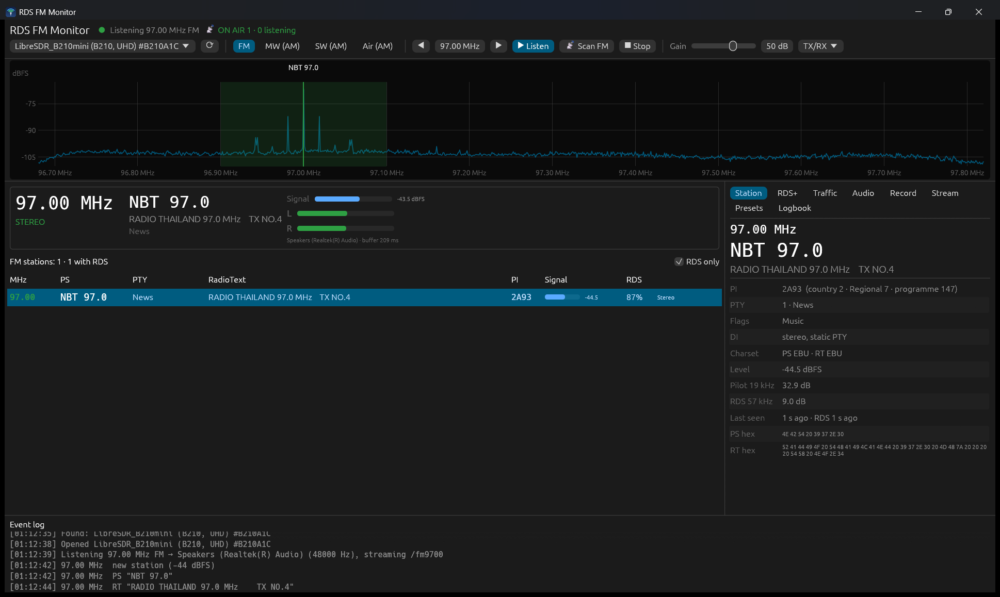

<p align="center"></p>

# RDS FM Monitor

**A software-defined radio app I built for fun.** It started as "can I decode the RDS text from Bangkok FM stations with a cheap B210 clone?" It ended up as a full radio: FM stereo, AM, RDS, traffic info, an equalizer, a recorder and an internet radio server. It's all Rust, with no GNU Radio and no Python, and DSP written from scratch.

> ⚠️ Hobby project. It works on my desk (LibreSDR B210mini on USB 2.0, Windows 11, Bangkok). Your mileage, antenna and local regulations may vary. **Receive only.** The app never transmits.



## What it does

| | |
|---|---|
| 📡 **FM band scan** | Sweeps 87.5–108 MHz and decodes the RDS of every station it finds at the same time |
| 🎧 **Live radio** | FM stereo (pilot PLL, 50/75 µs de-emphasis), MW / SW / airband AM, with a real-time spectrum |
| 📝 **RDS, the whole thing** | PI (country/area), PS, RadioText, **RT+** (title/artist), PTY/PTYN, clock, AF, ECC, PIN, DI, Long PS, **EON**, ODA, eRT, BLER stats and raw groups |
| 🚦 **Traffic** | TP/TA banner during traffic announcements, EON traffic, **RDS-TMC** decoding (one click downloads the event list) |
| 🎚️ **Audio** | 10-band EQ with presets, output device selection, auto stereo / forced mono |
| ✨ **"Make it sound like a CD"** | **AI noise reduction** (RNNoise neural net), bandwidth extension (harmonic exciter above the 15 kHz FM cut-off) and stereo width. Physics still applies: this adds plausible detail, it can't recover what was never broadcast. |
| ⏺️ **Recording** | WAV (16/24/32f), FLAC, MP3 (with ID3 tags taken from RDS), AAC-LC/HE, up to 96 kHz |
| 🌐 **Internet radio** | Built-in Icecast-style server (MP3 + ICY "now playing" from RDS) and push to a real Icecast server. **Several stations at once** from a single capture. |
| ⭐ **Presets & logbook** | Memory channels (CSV import/export) and a logbook of every station/PS/RT/TA/TMC event (CSV) |

## Hardware

| | LibreSDR B210mini / USRP B2xx | RTL-SDR Blog V4 |
|---|---|---|
| Driver | [UHD](https://files.ettus.com/binaries/uhd/) 4.x, C API loaded at runtime | `rtlsdr.dll` (RTL-SDR Blog build) + WinUSB via Zadig |
| Range | 50 MHz – 6 GHz (no MW/SW) | 500 kHz – 1.766 GHz (V4 HF upconverter) |
| FM scan | 4.56 MS/s, 4 MHz per hop | 2.28 MS/s, 2 MHz per hop |
| Multi-station streaming | ≈ ±1.8 MHz around the tuned station | ≈ ±0.85 MHz |

Lessons learned the hard way:
- **UHD 4.11 compares serial numbers as hex.** My clone shipped with serial `OVXI4WE`, so it was never found when the serial was given (SDRangel always gives one). The fix is to burn a hex serial: `usrp_burn_mb_eeprom --args type=b200 --values serial=B210A1C`.
- USB 2.0 tops out at ~8 MS/s sc16, so everything here is designed to stay at or below 4.56 MS/s.
- Some RDS error correction is good. Too much is bad: correcting 5-bit bursts turned `MUSIC` into `MUSQL`.

## Build & run

```powershell
cargo build --release
target\release\rds-fm-gui.exe            # the app
target\release\rds-fm-gui.exe tune 97.0  # start on a station
target\release\rds-fm.exe devices        # list SDRs
target\release\rds-fm.exe tune 97.0 --stream 0.0.0.0:8000 --also 95.5,98.5   # headless, 3 streams
target\release\rds-fm.exe selftest       # synthetic-signal self test, no hardware needed
target\release\rds-fm.exe tmc-download   # fetch the RDS-TMC event list
```

Needs Rust (MSVC) on Windows. The encoders (LAME, FDK-AAC) are compiled from source by their crates. Close SDRangel first, because only one program can own the SDR. Settings, logbook and TMC data live in `%APPDATA%\rds-fm`.

Streams are at `http://<your-pc>:8000/` (player page), `/fm9700` (97.00 MHz), `/am891` (891 kHz). They work in browsers, VLC, foobar2000, Winamp and so on. To reach listeners outside your network, forward the port on your router or push to an Icecast server.

## How it works (the fun part)

```
scan:   burst capture ─► one big FFT ─► station finder (power centroid) ─► per-station FFT slice ─► FM discriminator ─► MPX
listen: continuous IQ ─► overlap-save FFT channelizer (N stations, one FFT, phase-continuous)
          FM: MPX 228 kHz ─┬─ 19 kHz pilot PLL ─► 38 kHz L−R ─► FIR 15 kHz ÷5 ─► de-emphasis ─► L/R
                           └─ RDS every 2.3 s
          AM: |z| ─► carrier-referenced AGC
        ─► 48 kHz ─► EQ ─► RNNoise + exciter ─┬─► recorder (WAV ─► FLAC/MP3/AAC)
                                              ├─► LAME ─► stream hub ─► HTTP listeners / Icecast
                                              └─► volume ─► drift-tracking resampler ─► WASAPI
RDS:    57 kHz baseband ─► carrier from pilot³ (or BPSK squaring) ─► biphase matched filter ─► differential decode
        ─► syndrome sync ─► ≤2-bit burst correction ─► groups 0A…15A ─► "seen twice" debounce for text
```

Every rate is a multiple of 228 kHz (12 × 19 kHz), so shifting, filtering and decimating are just picking FFT bins. Thai PS/RT text in TIS-620 is detected automatically.

## Tests

```powershell
cargo test --release
```
These cover RDS checkwords and burst correction, RT+/EON/TA/TMC parsing, channelizer phase continuity, two stations from one FFT, stereo separation (> 30 dB), AM, the resampler, EQ, RNNoise and the exciter, all four recording formats, the HTTP stream server with ICY metadata, and an end-to-end decode of synthetic stations (including Thai RadioText).

## Credits & licenses of things I didn't write
- [RNNoise](https://jmvalin.ca/demo/rnnoise/) by Jean-Marc Valin, via [`nnnoiseless`](https://crates.io/crates/nnnoiseless)
- LAME (`mp3lame-encoder`), Fraunhofer FDK AAC (`fdk-aac`), `flacenc`, `hound`, `cpal`, `egui`/`eframe`, `rustfft`
- The RDS-TMC event list is **not** bundled. The app downloads it on request from [GNU Radio gr-rds](https://github.com/bastibl/gr-rds) (GPL-2.0+), and it stays on your PC.
- UHD by Ettus Research. librtlsdr by osmocom, in the RTL-SDR Blog build.

License: not decided yet. Ask me if you want to use it.
